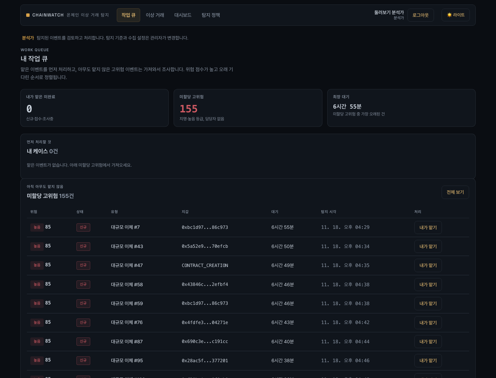
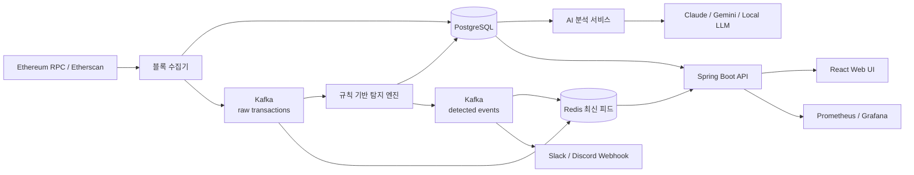

# ChainWatch

[](https://github.com/bitofsyn/ChainWatch/actions/workflows/ci.yml)
[](https://github.com/bitofsyn/ChainWatch/actions/workflows/cd.yml)

> 가상자산 거래소의 이상거래 모니터링 담당자를 위한 이더리움 관제 도구

ChainWatch는 이더리움에서 자사 입출금 지갑·제재 주소·관심 주소가 얽힌 위험 거래를 놓치지 않고, 탐지 근거를 바탕으로 검토한 뒤 처리 결과를 기록으로 남기도록 돕습니다. 판정은 재현 가능한 규칙이 하고, AI(LLM)는 검토를 돕는 요약만 씁니다.

## 누가, 언제, 어떻게 쓰나

| | |
|---|---|
| **누가** | 거래소 리스크·AML(자금세탁방지) 팀. 분석가는 매일 이벤트를 처리하고, 팀 리드(관리자)는 탐지 기준과 예외를 승인하며, 준법감시인·감사(조회자)는 현황과 근거를 열람합니다 |
| **언제** | 새 블록(약 12초)마다 자동으로 탐지합니다. 분석가는 근무 중 작업 큐를 열거나, 위험 점수 70점 이상 알림(Slack·Discord)을 받으면 바로 확인합니다 |
| **무엇을** | 제재 주소 연루, 자사 지갑의 대량 입출금, 100 ETH 이상 이체, 여러 주소로 자금 쪼개기, 짧은 시간 반복 이체, 관심 주소 활동 |
| **어떻게** | 위험도·대기 시간 순 작업 큐에서 이벤트를 맡고, 탐지 근거·거래·지갑의 거래 상대를 확인한 뒤(AI 요약은 참고) 해결·오탐 사유를 남겨 종결합니다. 오탐이 잦은 지갑은 예외로 제안하고, 팀 리드가 승인하면 다음부터 탐지에서 빠집니다 |
| **왜** | 하루 100만 건이 넘는 거래를 사람이 모두 볼 수 없고, 나중에 왜 걸렸는지와 누가 어떻게 처리했는지를 설명할 수 있어야 하기 때문입니다. 그래서 AI가 판정하지 않고 규칙이 근거를 남깁니다 |

**사용 장면**: 오전 9시, 분석가가 출근해 작업 큐를 엽니다. 밤사이 쌓인 고위험 이벤트 가운데 제재 주소와 얽힌 건이 맨 위에 있습니다. 탐지 근거와 지갑의 거래 상대를 확인하고 AI 요약을 참고해 조사중으로 바꾼 뒤 메모를 남깁니다. 정상 영업 패턴인데 계속 걸리는 고객 지갑은 예외로 제안하고, 팀 리드가 오후에 승인합니다.

## 배포 주소

- **Web UI**: [https://chainwatch.devfolio-2026.workers.dev](https://chainwatch.devfolio-2026.workers.dev)
- **Backend 상태 확인**: [https://chainwatch-backend.onrender.com/actuator/health](https://chainwatch-backend.onrender.com/actuator/health)

로그인 화면의 **둘러보기**로 바로 체험할 수 있습니다.

- **데모 가정**: Kraken의 공개 지갑 2개를 자사 입출금 지갑으로, THORChain 라우터를 관심 주소로 등록했고, OFAC 제재 주소 목록은 매일 동기화합니다.
- **무료 인스턴스 한계**: 방문이 없으면 서버가 잠들고 그동안은 수집하지 않습니다. 다시 깨어나면 최신 블록부터 이어서 수집하며, 첫 응답에 1분가량 걸릴 수 있습니다.

## 주요 기능

- RPC·Etherscan 기반 블록·거래 수집
- 대규모 이체, 반복 이체, 자금 분산, 자사 입출금 지갑·관심 주소·제재 주소 탐지
- 위험도, 탐지 근거, 처리 이력을 포함한 분석가 작업 큐
- 예외 주소 제안·승인과 런타임 탐지 정책 관리
- JWT 역할 제어, 감사 로그, Slack·Discord 알림
- LLM 분석 보고서와 Prometheus·Grafana 모니터링

## 화면

| 역할 | 실제 사용자 | 첫 화면 | 하는 일 |
|---|---|---|---|
| 조회자 | 준법감시인·감사 | 대시보드 | 탐지 현황, 이상 거래와 탐지 근거, 처리 이력, 적용 중인 규칙 조회 |
| 분석가 | 이상거래 모니터링 담당자 | 작업 큐 | 이벤트를 맡아 접수 → 조사중 → 해결·오탐 종결로 처리, 예외 주소 제안 |
| 관리자 | 리스크팀 리드 | 운영 설정 | 탐지 기준과 자사 지갑·관심 주소, 예외 승인, 블록 수집, 알림, 사용자 계정, 감사 로그 관리 |


### 분석가

| 작업 큐 | 이벤트 상세 |
|---|---|
|  |  |
| 담당·미할당 이벤트를 우선순위로 정렬합니다. | 탐지 근거, 거래 증거, 처리 이력을 함께 보여줍니다. |


### 관리자


### 대시보드


## 시스템 구조



Kafka 없이도 단독 실행할 수 있습니다. 상세 구조는 [시스템 구조 문서](docs/architecture.md)를 참고하세요.

## 기술 스택

| 영역 | 기술 |
|---|---|
| Backend | Java 21, Spring Boot 3.5, Spring Security, Spring Data JPA, Web3j |
| Frontend | React 18, TypeScript, Vite, Vitest |
| AI Server | Python, FastAPI, Pydantic |
| Database | PostgreSQL 16, H2 |
| Messaging / Cache | Apache Kafka, Redis |
| Monitoring | Spring Actuator, Micrometer, Prometheus, Grafana |
| Infrastructure | Docker, Docker Compose, Nginx |

## 부하 테스트

거래 351만 건·탐지 이벤트 9.5만 건이 쌓인 로컬 환경에서 k6·JMeter로 조회 API를 검증했습니다.

| 구간 | 실제 TPS | p95 | p99 | 오류 | Drop |
|---|---:|---:|---:|---:|---:|
| 개선 전 150 TPS | 139.47 | 2.31s | 3.18s | 0% | 59 |
| 개선 후 150 TPS | 149.94 | 9.32ms | 10.71ms | 0% | 0 |
| 개선 후 500 TPS | 499.65 | 7.31ms | 9.00ms | 0% | 0 |

[상세 결과](load-tests/REPORT-2026-11-23.md) · [실행 방법](load-tests/README.md)

## 빠른 시작

Docker Desktop에서 실행합니다.

```bash
docker compose --profile app up --build -d   # 전체 서비스 실행
docker compose --profile app down            # 종료
```

| 서비스 | 로컬 주소 |
|---|---|
| Web UI | http://127.0.0.1:8088 |
| Backend API | http://127.0.0.1:18080 |
| Swagger UI | http://127.0.0.1:18080/swagger-ui.html |
| Grafana · Prometheus | http://127.0.0.1:3000 · http://127.0.0.1:9090 (`--profile monitoring`) |

## 문서

| 문서 | 내용 |
|---|---|
| [시스템 구조](docs/architecture.md) | 처리 흐름, 탐지 규칙과 판단 근거, AI 분석 방식 |
| [실행·설정·테스트](docs/operations.md) | 환경변수, 운영 설정, 개별 실행과 테스트, CI/CD, 보안 주의사항 |
| [배포](docs/deployment.md) | Cloudflare Workers·Render 자동 배포와 AI 분석 서버 연결, Quick Tunnel 임시 공개, Oracle Cloud 상시 운영 |
| [주요 API](docs/api.md) | 전체 API 목록과 역할별 권한 |
| [부하 테스트](load-tests/README.md) | k6·JMeter 기반 스모크·점진 부하·정속 TPS 테스트 |
