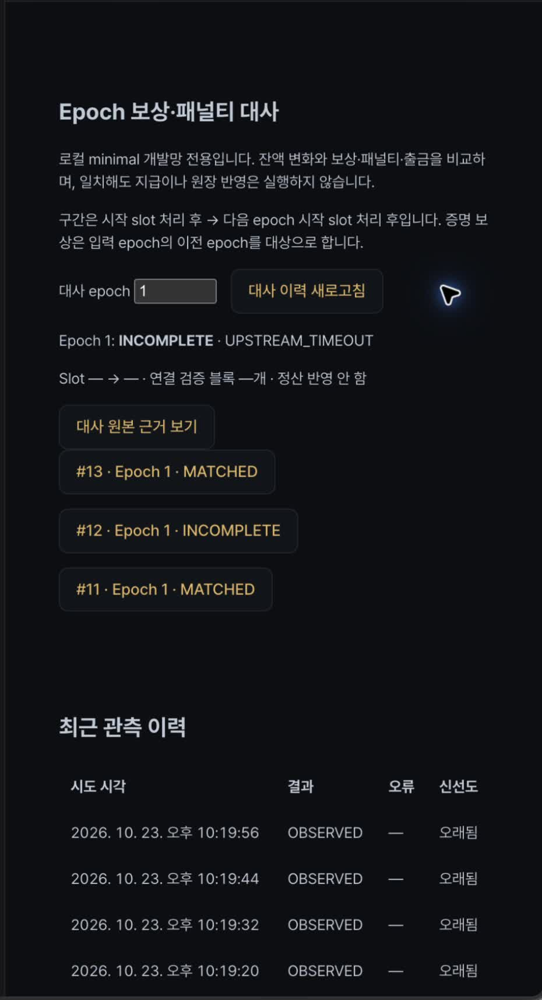

# ChainWatch — 검증인 관측·보상 대사 v1

테스트 블록체인의 검증인 잔액 변화가 **보상·패널티·출금으로 설명되는지 확인하고, 판단에 사용한 원본과 실패 이력을 보존하는 운영 서비스**입니다.

Java 21 / Spring Boot 3 / PostgreSQL 16 / React / Geth / Teku를 사용합니다. Spring은 노드에 관측을 요청하고 대사하며 합의·서명을 재구현하지 않습니다.

## 해결하는 문제

검증인 잔액의 증감에는 보상뿐 아니라 패널티·예치·출금이 섞입니다. 잔액 차이를 그대로 보상으로 집계하거나, 서로 다른 시점의 응답을 비교하면 잘못된 정상 판정이 생길 수 있습니다.

ChainWatch는 **확정된 구간을 고정하고, 보상·패널티·출금으로 잔액 변화가 설명되는지 대사**합니다. 자료가 부족하거나 지원하지 않는 흐름은 추정하지 않고 보류합니다.

## 핵심 흐름

```text
Teku / Beacon API                 Geth / JSON-RPC
확정 상태 · 보상 · 블록             execution 블록
          └──────────┬──────────────────┘
                 Spring Boot
        시점 고정 → 블록 연결 검증 → gwei 대사
                     │
                 PostgreSQL
          실행 시도 · 부분 원본 · 감사 이력
                     │
                  React UI
             관측 · 결과 · 실패 근거 조회
```

| 결과 | 의미 |
|---|---|
| MATCHED | 지원 범위에서 기초 잔액 + 보상 - 패널티 - 출금 = 기말 잔액 |
| MISMATCH | 자료를 검증했으나 설명되지 않는 차액이 존재 |
| INCOMPLETE | 미확정·응답 누락·미지원 흐름으로 판정 보류 |

RPC 호출 전에 실행 시도를 저장하고, 실패해도 수집한 부분 원본과 이력을 남깁니다. 같은 구간을 재실행하면 별도 시도가 생기며 이전 실패를 덮어쓰지 않습니다.

## 실제 검증 결과

2026-10-23, Geth·Teku 로컬 개발망과 PostgreSQL에서 검증했습니다.

| 단계 | 결과 |
|---|---|
| 확정 진행 | finalized slot 16 → 24 확인 |
| 정상 대사 | epoch 1, #11 MATCHED |
| Teku 프로세스 일시 정지 | #12 INCOMPLETE / UPSTREAM_TIMEOUT, 5.025초 |
| 프로세스 재개 후 재실행 | #13 MATCHED, 장애 전후 보고서 동일 |
| 잔액 대사 | 검증인 3명의 미설명 차액 모두 0 gwei |

[실험 결과 JSON](docs/evidence/staking-v1-outage.json) · [대사 설계와 검증 기록](docs/SERVICE_DEFINITION_V3.md#12-확정-블록-연결-및-epoch-대사-2026-10-23)

위 시간은 1회 실험값입니다. 노드 무응답과 수동 재실행을 검증했으며, 검증인 재시작이나 작업 자동 복구를 검증한 결과는 아닙니다.

## 데모

[관측·대사 화면](http://127.0.0.1:5186/#/staking)에서 다음 순서로 확인할 수 있습니다.

1. 네트워크·확정 slot·검증인 상태와 잔액 확인
2. epoch 1 대사 결과와 원본 근거 조회
3. 기록된 INCOMPLETE 시도의 오류 확인
4. 복구 후 MATCHED 시도와 비교

[데모 영상 보기 · MP4](docs/demo/chainwatch-v1-demo.mp4) · [한국어 설명 자막 · SRT](docs/demo/chainwatch-v1-demo.ko.srt)

[](docs/demo/chainwatch-v1-demo.mp4)

2026-10-24 녹화, 약 2분 5초, 무음입니다. **2026-10-23에 저장한 실험 결과를 조회**하며 녹화 중 새 장애를 주입하거나 대사를 실행한 영상은 아닙니다. 세로 화면에 보상·패널티·차액을 표시하며 오른쪽 잔액 구성 열 일부는 화면 밖에 있습니다. MP4는 끝부분의 데모와 무관한 화면을 제외하고 원본 영상 스트림을 재인코딩 없이 보존했습니다. 자막은 별도 SRT 파일로 제공하며 플레이어에서 함께 열 수 있습니다.

| 영상 구간(약) | 내용 |
|---|---|
| 00:00 | 서비스 소개 |
| 00:17 | 확정 slot·검증인 관측 |
| 00:30 | 정상 대사 #11 |
| 00:54 | timeout / INCOMPLETE #12 |
| 01:15 | 복구 MATCHED #13 |
| 01:40 | 원본 API 응답 |
| 02:00 | 서비스 범위 안내 |

[설명 대본](docs/PORTFOLIO_V1.md#3분-녹화-대본) · [앱 내 안내](http://127.0.0.1:5186/#/demo)

## 지원 범위

- 로컬 minimal 개발망, Electra/Fulu, 최대 4,096개 검증인 상태에서 설정된 검증인만 대사
- 정수 gwei 계산, 확정 state root 고정, Beacon payload와 Geth 블록 대조
- 미지원 예치·슬래싱·종료 흐름, 누락 자료, 경계 fork 전환은 INCOMPLETE
- 고객별 지분·원장·지급, execution 수수료/MEV 수익 대사, 공개망 장기 운영은 제외

**MATCHED는 수집 자료 간 일치이며 지급 승인이 아닙니다.** SSZ root·서명·합의 상태 전이의 독립 검증기도 아닙니다. full state를 수집하는 현재 방식은 공개망 규모를 위한 설계가 아닙니다.

## 빠른 시작

필수: Java 21, Node.js/npm, Python 3, Docker Desktop, [Kurtosis CLI](https://docs.kurtosis.com/install/) 1.22.2. 아래 명령은 저장소 루트 기준입니다. 실제 개발망은 컨테이너 여러 개를 실행하므로 개발 머신의 여유 자원을 확인합니다.

### 1. 데이터베이스와 개발망

```bash
docker compose -f compose.staking-lab.yml up -d
kurtosis run --enclave chainwatch-v1 github.com/ethpandaops/ethereum-package@3ad03186953bfa27e9060860aa9d636ea496f010 --args-file scripts/staking/devnet.yaml
kurtosis port print chainwatch-v1 cl-1-teku-geth http
kurtosis port print chainwatch-v1 el-1-geth-teku rpc
```

Compose 프로젝트 이름은 `chainwatch-staking-lab`으로 고정되어 기존 서비스 DB와 구분됩니다. 빈 DB는 V001~V003을 자동 적용합니다. V001·V002가 적용된 이전 volume에는 V003을 별도 적용합니다:

```bash
docker compose -f compose.staking-lab.yml exec -T postgres psql -U staking_lab -d staking_lab < backend/src/main/resources/db/staking/V003__staking_reconciliations.sql
```

### 2. 백엔드 — 별도 터미널

위에서 출력된 포트를 사용합니다. execution RPC 출력에 프로토콜이 없으면 `http://`를 붙입니다.

```bash
python3 scripts/staking/run_devnet_backend.py --beacon-url http://127.0.0.1:<Beacon포트> --execution-url http://127.0.0.1:<RPC포트>
```

서버는 `127.0.0.1:18090`, DB는 `127.0.0.1:55433`입니다. 개발망 genesis 시각을 network 이름에 포함해 새 실험의 이력을 분리합니다.

### 3. 프론트 — 별도 터미널

```bash
npm --prefix frontend ci
cd frontend
API_PROXY_TARGET=http://127.0.0.1:18090 npm run dev -- --host 127.0.0.1 --port 5186
```

[관측·대사 화면](http://127.0.0.1:5186/#/staking)과 [3분 데모 안내](http://127.0.0.1:5186/#/demo)를 엽니다. 로컬 개발 계정은 `admin / chainwatch`입니다. 이 프로필은 JWT 비활성·개발 자격증명을 사용하므로 외부에 공개하지 않습니다. JWT 활성 환경의 ADMIN/ANALYST 권한은 API 테스트에서 검증합니다.

### 4. 재현 검증 — 저장소 루트에서

```bash
python3 scripts/staking/smoke_devnet.py
python3 scripts/staking/smoke_reconciliation.py --epoch 1
```

epoch 1 대사는 종료 slot 16이 확정된 뒤 가능합니다. 아직 확정되지 않았다면 INCOMPLETE로 기록되므로 몇 분 뒤 재시도합니다. 누락 블록이 있는 구간은 지원 범위 밖으로 보류하며, 자동으로 성공할 때까지 epoch를 바꾸지 않습니다.

노드 장애 실험은 Beacon URL에 연결된 **전용 Teku 컨테이너** 이름을 `docker ps`에서 확인한 뒤 실행합니다. 다른 프로젝트나 실제 자산을 사용하는 노드에서는 실행하지 않습니다.

```bash
python3 scripts/staking/smoke_outage.py --container cl-1-teku-geth--<컨테이너ID> --epoch 1 --output /tmp/chainwatch-outage.json
```

스크립트는 정상 대사 후 프로세스를 일시 정지하여 timeout을 확인하고 `finally`에서 재개합니다. SIGKILL·Docker 자체 장애로 정리하지 못했다면 `docker unpause <동일컨테이너>`로 복구합니다. **검증인 재시작이나 자동 worker 복구를 검증하는 실험은 아닙니다.**

실제 재현 결과: **MATCHED → UPSTREAM_TIMEOUT / INCOMPLETE → MATCHED**, 복구 전후 보고서 동일, 검증인 3명 미설명 차액 0 gwei. [2026-10-23 실험 기록](docs/evidence/staking-v1-outage.json)을 참고하세요.

## 테스트

대사 자동 테스트는 보상·패널티·출금 합산, 1 gwei 불일치, 잘못된 체인·execution hash, 누락 응답, 미확정 상태, 권한·입력 오류를 다룹니다. 로컬 개발망 smoke는 실제 클라이언트 연동을 검증합니다. 두 검증을 구분하며 단위 테스트 통과를 공개망 운영 실적으로 간주하지 않습니다.


```bash
(cd backend && ./gradlew test)
npm --prefix frontend run build
npm --prefix frontend test
```

## 읽을 문서

- [포트폴리오 원고·경력기술서 요약·3분 녹화 대본](docs/PORTFOLIO_V1.md)
- [서비스 정의·아키텍처·대사 설계·검증 결과](docs/SERVICE_DEFINITION_V3.md) — 12절: 대사 구간과 보류 조건, 13절: v1 범위 및 데모
- `scripts/staking/` — 고정 fixture, 실제 개발망 설정, 실행 도구와 검증 스크립트
- `backend/src/main/resources/db/staking/` — 명시적 스키마 migration

이전 이상거래 탐지·AI 기능은 저장소에 남아 있지만 v1 핵심 메뉴와 제출 범위에서 제외했습니다. 과거 기능의 실행·배포 안내는 [운영 가이드](docs/OPERATIONS.md), [로컬 인프라](docs/LOCAL_INFRA_SETUP.md), [기존 API 계약](docs/WAVE1_BACKEND_CONTRACTS.md)을 참고합니다.

## 종료

백엔드·프론트 터미널은 Ctrl+C로 종료하고 개발망·DB는 아래처럼 정상 중지합니다. 볼륨과 이력은 보존됩니다.

```bash
kurtosis enclave stop chainwatch-v1
docker compose -f compose.staking-lab.yml stop
```

머신 강제 종료 후 keystore lock으로 검증인이 기동하지 않을 경우 키 잠금을 임의로 제거하거나 동일 키를 다른 노드에서 동시에 기동하지 않습니다. 기존 enclave를 중지·보존하고 새 이름의 독립 실험망을 구성하는 방법과 실제 발생 이력은 서비스 정의 12절에 기록했습니다.
