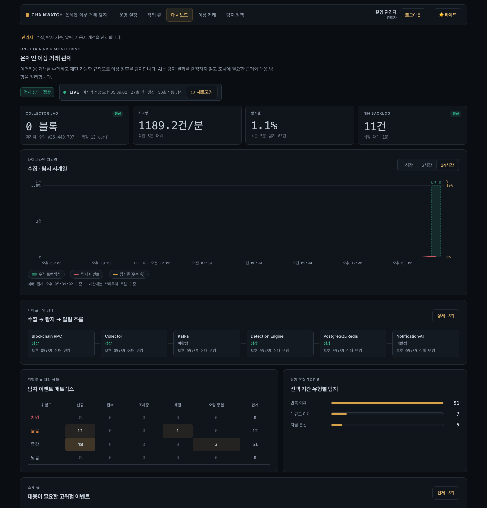
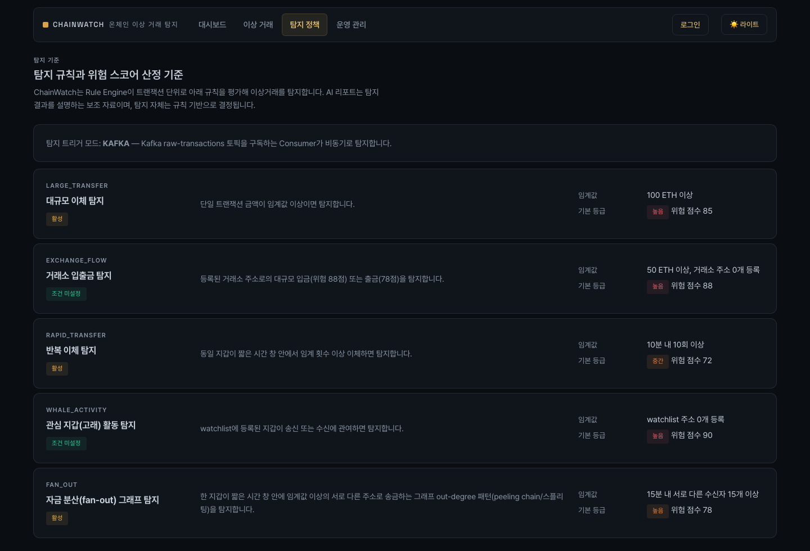
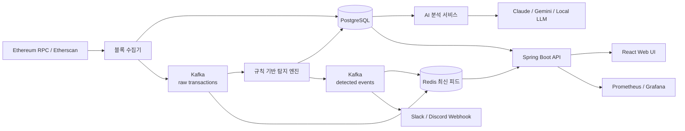

# ChainWatch

[](https://github.com/bitofsyn/ChainWatch/actions/workflows/ci.yml)
[](https://github.com/bitofsyn/ChainWatch/actions/workflows/cd.yml)

> AI를 활용해 블록체인 거래 데이터를 분석하고 이상 징후를 탐지하는 모니터링 시스템

ChainWatch는 이더리움 블록과 트랜잭션을 수집하고, 규칙 기반 탐지 엔진으로 의심스러운 거래 패턴을 식별하는 프로젝트입니다. 탐지된 이벤트는 위험도와 근거 데이터와 함께 저장되며, 필요한 경우 LLM이 이벤트를 추가 분석해 사람이 검토하기 쉬운 보고서를 생성합니다.

단순히 AI에게 거래 판단을 맡기지 않고, **재현 가능한 규칙이 먼저 이상 징후와 근거를 생성하고 AI는 그 결과를 해석하는 보조 계층으로 동작**하도록 구현했습니다.

## 주요 기능

- 이더리움 RPC·Etherscan 기반 블록·트랜잭션 수집 (폴링, WebSocket)
- 고액 송금, 반복 송금, 자금 분산 등 규칙 기반 이상 거래 탐지와 탐지 근거 저장
- Claude·Gemini·로컬 LLM을 이용한 이벤트 분석 리포트와 제공자 폴백
- 이벤트 처리 상태 관리, 거래·지갑 상세 추적
- JWT 인증과 역할 기반 접근 제어, 감사 로그, Slack·Discord 알림
- Prometheus·Grafana 모니터링

## 화면



*수집 지연, 처리량, 탐지율과 미처리 backlog를 확인하고, 수집 → 탐지 → 알림 파이프라인의 단계별 상태와 위험도 × 처리 상태 매트릭스를 한 화면에서 봅니다.*

| 이상 거래 검토 | 이벤트 상세 |
|---|---|
|  |  |
| 규칙이 탐지한 이벤트를 유형, 위험도, 처리 상태, 지갑 주소로 검색합니다. | 위험 점수와 규칙이 발화한 근거(임계값, 관측값, 집계 구간), 온체인 트랜잭션 증거를 나란히 보여줍니다. |



*현재 적용 중인 규칙별 임계값과 기본 위험 점수를 확인합니다. 관리자는 운영 관리 화면에서 임계값, 자동 수집, 웹훅 알림을 재시작 없이 변경합니다.*

> 위 화면은 로컬 Docker 환경에서 이전에 수집한 메인넷 데이터로 캡처했습니다.

## 시스템 구조



수집·탐지·알림 단계는 Kafka로 분리되어 있어 외부 서비스가 느려져도 전체 파이프라인이 함께 멈추지 않습니다. 처리 흐름과 탐지 규칙, AI 분석 방식은 [시스템 구조 문서](docs/architecture.md)에 정리했습니다.

## 기술 스택

| 영역 | 기술 |
|---|---|
| Backend | Java 21, Spring Boot 3.5, Spring Security, Spring Data JPA, Web3j |
| Frontend | React 18, TypeScript, Vite, Vitest |
| AI Server | Python, FastAPI, Pydantic |
| Database | PostgreSQL 16, H2 |
| Messaging / Cache | Apache Kafka, Redis |
| Monitoring | Spring Actuator, Micrometer, Prometheus, Grafana |
| Infrastructure | Docker, Docker Compose, Nginx |

## 빠른 시작

Docker Desktop이 필요합니다. 저장소 루트에서 실행합니다.

```bash
docker compose --profile app up --build -d   # 전체 서비스 실행
docker compose --profile app down            # 종료
```

| 서비스 | 로컬 주소 |
|---|---|
| Web UI | http://127.0.0.1:8088 |
| Backend API | http://127.0.0.1:18080 |
| Swagger UI | http://127.0.0.1:18080/swagger-ui.html |
| Grafana · Prometheus | http://127.0.0.1:3000 · http://127.0.0.1:9090 (`--profile monitoring`) |

## 문서

| 문서 | 내용 |
|---|---|
| [시스템 구조](docs/architecture.md) | 처리 흐름, 탐지 규칙과 판단 근거, AI 분석 방식 |
| [실행·설정·테스트](docs/operations.md) | 환경변수, 운영 설정, 개별 실행과 테스트, CI/CD, 보안 주의사항 |
| [배포](docs/deployment.md) | Cloudflare Workers·Render 자동 배포, Quick Tunnel 임시 공개, Oracle Cloud 상시 운영 |
| [주요 API](docs/api.md) | 이벤트·거래·지갑·탐지 규칙·운영 설정·인증 API 목록 |
