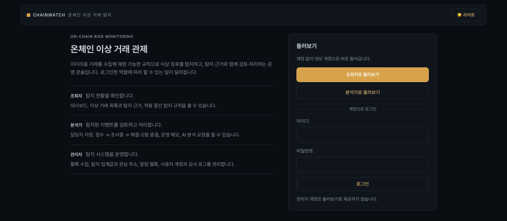
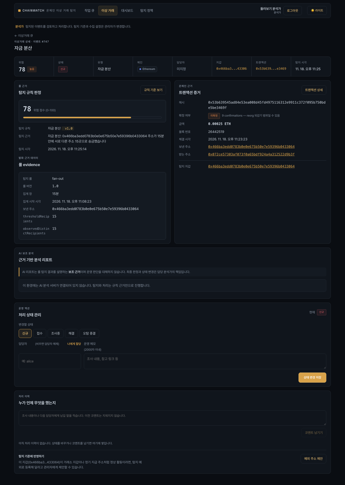
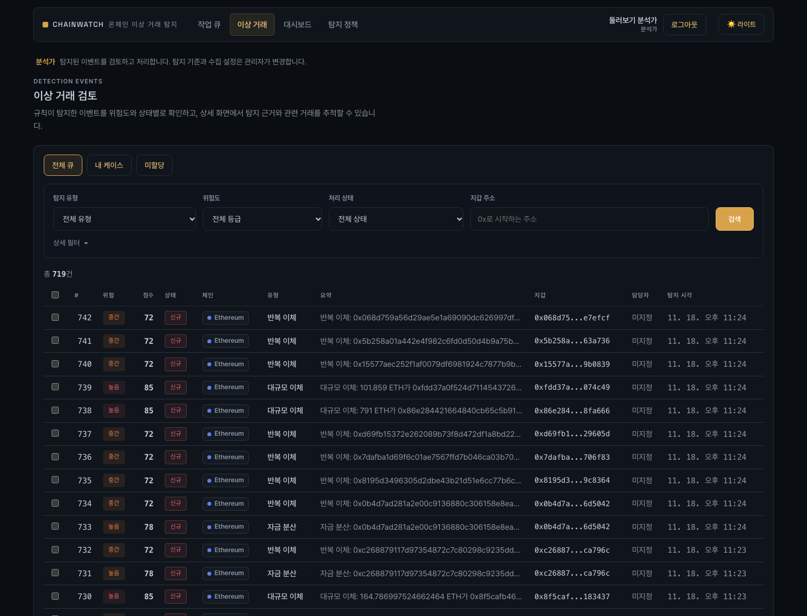
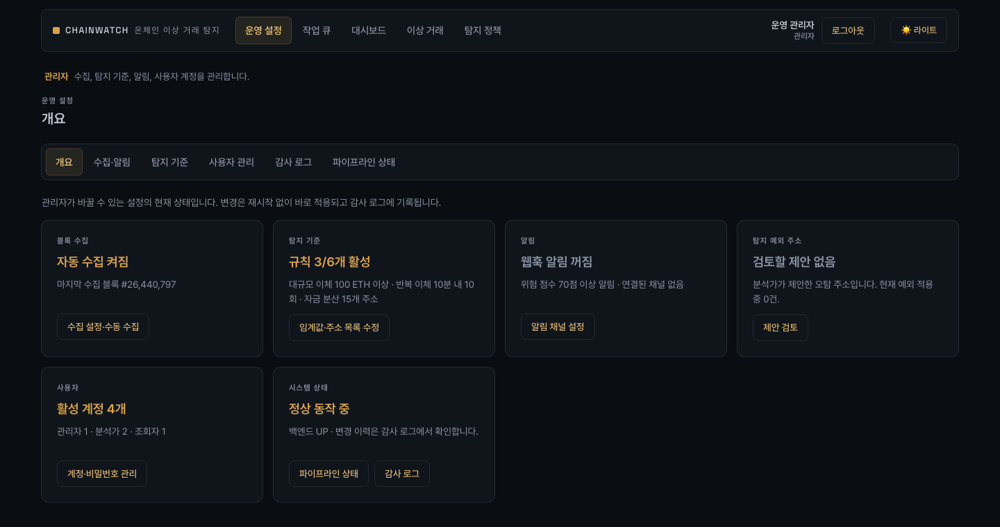
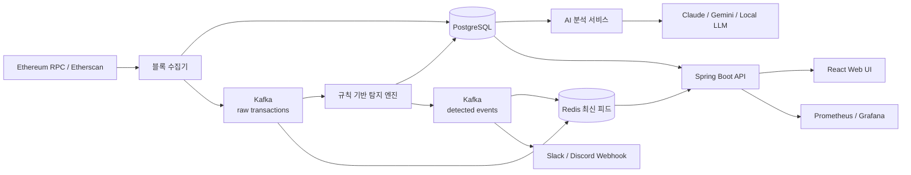

# ChainWatch

[](https://github.com/bitofsyn/ChainWatch/actions/workflows/ci.yml)
[](https://github.com/bitofsyn/ChainWatch/actions/workflows/cd.yml)

> AI를 활용해 블록체인 거래 데이터를 분석하고 이상 징후를 탐지하는 모니터링 시스템

ChainWatch는 이더리움 블록과 트랜잭션을 수집하고, 규칙 기반 탐지 엔진으로 의심스러운 거래 패턴을 식별하는 프로젝트입니다. 탐지된 이벤트는 위험도와 근거 데이터와 함께 저장되며, 필요한 경우 LLM이 이벤트를 추가 분석해 사람이 검토하기 쉬운 보고서를 생성합니다.

단순히 AI에게 거래 판단을 맡기지 않고, **재현 가능한 규칙이 먼저 이상 징후와 근거를 생성하고 AI는 그 결과를 해석하는 보조 계층으로 동작**하도록 구현했습니다.

## 배포 주소

- **Web UI**: [https://chainwatch.devfolio-2026.workers.dev](https://chainwatch.devfolio-2026.workers.dev)
- **Backend 상태 확인**: [https://chainwatch-backend.onrender.com/actuator/health](https://chainwatch-backend.onrender.com/actuator/health)

계정이 없어도 로그인 화면의 **둘러보기** 버튼으로 조회자 또는 분석가 화면에 바로 들어갈 수 있습니다.

프런트엔드는 Cloudflare Workers, 백엔드는 Render에 배포되어 있으며 `main`의 CI가 성공하면 자동으로 재배포됩니다. 배포 환경은 Kafka·Redis 없이 단독으로 실행합니다. Render 무료 인스턴스는 일정 시간 요청이 없으면 중지되므로 첫 접속 시 응답이 늦을 수 있습니다. AI 분석 서버는 별도 Render 서비스로 연결되어 Gemini로 리포트를 만듭니다. AI 서버가 잠들어 있으면 첫 분석에 1분가량 더 걸리기도 합니다. 무료 한도를 아끼려고 자동 분석은 끄고 분석가가 이벤트 상세에서 요청한 건만 분석합니다. 블록 수집은 관리자가 운영 설정에서 수동으로 실행하거나 자동 수집을 켜서 진행합니다.

## 주요 기능

- 이더리움 RPC·Etherscan 기반 블록·트랜잭션 수집 (수동 수집, 자동 폴링, WebSocket)
- 대규모 이체, 반복 이체, 자금 분산, 관심 주소, 거래소 입출금, 제재 주소 규칙 기반 탐지와 탐지 근거 저장
- 같은 지갑의 반복 탐지를 재탐지 억제 시간 동안 이벤트 1건으로 묶어 분석가 큐가 넘치지 않게 함
- 분석가 작업 큐, 이벤트 처리 이력·코멘트, 일괄 처리, 재오픈, 지갑별 거래 상대 조회
- 분석가의 탐지 예외 주소 제안과 관리자 승인으로 오탐을 탐지 기준에 반영
- 관리자 설정 화면에서 수집, 탐지 임계값·주소 목록, 알림, 사용자 계정을 재시작 없이 변경
- 조회자·분석가·관리자 역할별 화면과 접근 제어(JWT), 감사 로그, Slack·Discord 알림
- Claude·Gemini·로컬 LLM을 이용한 이벤트 분석 리포트와 제공자 폴백 (AI 분석 서버를 연결한 환경)
- Prometheus·Grafana 모니터링

## 화면

모든 화면은 로그인이 필요하고, 로그인한 역할에 따라 메뉴와 첫 화면이 달라집니다.

| 역할 | 첫 화면 | 하는 일 |
|---|---|---|
| 조회자 | 대시보드 | 탐지 현황, 이상 거래와 탐지 근거, 적용 중인 규칙 조회 |
| 분석가 | 작업 큐 | 이벤트를 맡아 접수 → 조사중 → 해결·오탐 종결로 처리, 예외 주소 제안 |
| 관리자 | 운영 설정 | 블록 수집, 탐지 기준, 알림, 사용자 계정, 감사 로그 관리 |



*역할별로 할 수 있는 일을 안내하고, 계정 없이 조회자·분석가 화면을 둘러볼 수 있습니다.*

### 분석가

| 작업 큐 | 이벤트 상세 |
|---|---|
|  |  |
| 내가 맡은 미완료 건과 아직 아무도 맡지 않은 고위험 건을 위험 점수와 대기 시간 순으로 보여줍니다. "내가 맡기"로 가져오면 접수 상태가 됩니다. | 규칙이 발화한 근거(기준 금액, 관측 금액)와 온체인 트랜잭션 증거를 나란히 보여주고, 상태 변경·담당자 지정·코멘트가 처리 이력으로 쌓입니다. |



*탐지된 이벤트를 유형, 위험도, 처리 상태, 지갑 주소로 검색하고 여러 건을 선택해 한 번에 처리합니다.*

### 관리자



*수집, 탐지 기준, 알림, 예외 주소 제안, 사용자, 시스템 상태의 현재 값을 카드로 보여주고 각 설정 화면으로 이동합니다. 변경은 재시작 없이 적용되고 감사 로그에 기록됩니다.*

### 대시보드


*수집 지연, 처리량, 탐지율, 미처리 backlog와 수집 → 탐지 → 알림 단계별 상태, 위험도 × 처리 상태 매트릭스를 한 화면에서 봅니다.*

> 위 화면은 배포된 서비스(단독 실행 구성: Kafka·Redis 없음)가 이더리움 메인넷 블록을 실시간 수집하는 상태에서 분석가 둘러보기 계정으로 캡처했습니다. 관리자 화면만 같은 구성을 로컬에 띄워 캡처했습니다.

## 시스템 구조



수집·탐지·알림 단계는 Kafka로 분리되어 있어 외부 서비스가 느려져도 전체 파이프라인이 함께 멈추지 않습니다. Kafka와 Redis 없이 실행하면 수집 요청 안에서 탐지를 바로 수행하고, 최신 피드는 DB에서 읽습니다. 처리 흐름과 탐지 규칙, AI 분석 방식은 [시스템 구조 문서](docs/architecture.md)에 정리했습니다.

## 기술 스택

| 영역 | 기술 |
|---|---|
| Backend | Java 21, Spring Boot 3.5, Spring Security, Spring Data JPA, Web3j |
| Frontend | React 18, TypeScript, Vite, Vitest |
| AI Server | Python, FastAPI, Pydantic |
| Database | PostgreSQL 16, H2 |
| Messaging / Cache | Apache Kafka, Redis |
| Monitoring | Spring Actuator, Micrometer, Prometheus, Grafana |
| Infrastructure | Docker, Docker Compose, Nginx |

## 빠른 시작

Docker Desktop이 필요합니다. 저장소 루트에서 실행합니다.

```bash
docker compose --profile app up --build -d   # 전체 서비스 실행
docker compose --profile app down            # 종료
```

| 서비스 | 로컬 주소 |
|---|---|
| Web UI | http://127.0.0.1:8088 |
| Backend API | http://127.0.0.1:18080 |
| Swagger UI | http://127.0.0.1:18080/swagger-ui.html |
| Grafana · Prometheus | http://127.0.0.1:3000 · http://127.0.0.1:9090 (`--profile monitoring`) |

## 문서

| 문서 | 내용 |
|---|---|
| [시스템 구조](docs/architecture.md) | 처리 흐름, 탐지 규칙과 판단 근거, AI 분석 방식 |
| [실행·설정·테스트](docs/operations.md) | 환경변수, 운영 설정, 개별 실행과 테스트, CI/CD, 보안 주의사항 |
| [배포](docs/deployment.md) | Cloudflare Workers·Render 자동 배포, Quick Tunnel 임시 공개, Oracle Cloud 상시 운영 |
| [주요 API](docs/api.md) | 이벤트·거래·지갑·탐지 규칙·운영 설정·인증 API 목록 |
