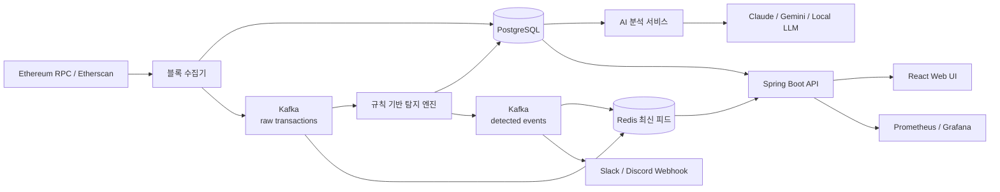

# ChainWatch

[](https://github.com/bitofsyn/ChainWatch/actions/workflows/ci.yml)

> AI를 활용해 블록체인 거래 데이터를 분석하고 이상 징후를 탐지하는 모니터링 시스템

ChainWatch는 이더리움 블록과 트랜잭션을 수집하고, 규칙 기반 탐지 엔진으로 의심스러운 거래 패턴을 식별하는 프로젝트입니다. 탐지된 이벤트는 위험도와 근거 데이터와 함께 저장되며, 필요한 경우 LLM이 이벤트를 추가 분석해 사람이 검토하기 쉬운 보고서를 생성합니다.

단순히 AI에게 거래 판단을 맡기지 않고, **재현 가능한 규칙이 먼저 이상 징후와 근거를 생성하고 AI는 그 결과를 해석하는 보조 계층으로 동작**하도록 구현했습니다.

## 화면

### 운영 대시보드


수집 지연, 처리량, 탐지율과 미처리 backlog를 한 화면에서 확인합니다. 수집 → 탐지 → 알림 파이프라인의 단계별 상태와 위험도 × 처리 상태 매트릭스로 지금 대응이 필요한 이벤트 규모를 파악합니다.

### 이상 거래 검토


규칙이 탐지한 이벤트를 유형, 위험도, 처리 상태, 지갑 주소로 검색합니다.

### 이벤트 상세


위험 점수와 함께 규칙이 발화한 근거(임계값, 실제 관측값, 집계 구간)와 온체인 트랜잭션 증거를 나란히 보여 줍니다. 로그인한 운영자는 처리 상태를 변경하거나 AI 분석 리포트를 요청할 수 있습니다.

### 탐지 정책


현재 적용 중인 규칙별 임계값과 기본 위험 점수를 확인합니다. 관리자는 **운영 관리** 화면에서 임계값, 자동 수집, 웹훅 알림을 재시작 없이 변경합니다.

## 주요 기능

- 이더리움 RPC 또는 Etherscan을 통한 블록·트랜잭션 수집
- 폴링 및 WebSocket 수집 방식 지원
- 규칙 기반 이상 거래 탐지와 탐지 근거 저장
- Kafka를 이용한 수집·탐지·알림 단계 분리
- Redis를 이용한 최신 거래·이벤트 피드와 알림 중복 방지
- Claude, Gemini, LM Studio, Hermes 기반 AI 분석 및 프로바이더 폴백
- 이벤트 상태 관리, 거래·지갑 상세 조회, 탐지 기준값 관리
- JWT 인증, 역할 기반 접근 제어와 감사 로그
- Slack·Discord Webhook 알림과 위험 점수 기준 설정
- Prometheus 지표와 Grafana 대시보드를 통한 운영 상태 확인

## 시스템 구조



## 탐지 규칙

| 탐지 유형 | 판단 기준 | 기본 위험도 |
|---|---|---|
| 고액 송금 (`LARGE_TRANSFER`) | 설정한 ETH 기준값 이상의 단일 송금 | HIGH |
| 단시간 반복 송금 (`RAPID_TRANSFER`) | 지정 시간 동안 동일 지갑에서 발생한 송금 횟수 | MEDIUM |
| 자금 분산 (`FAN_OUT`) | 지정 시간 동안 한 지갑이 다수의 서로 다른 주소로 송금 | HIGH |
| 거래소 자금 이동 (`EXCHANGE_FLOW`) | 등록된 거래소 주소와 기준값 이상의 자금 이동 | HIGH |
| 관심 주소 활동 (`WHALE_ACTIVITY`) | Watchlist에 등록된 주소가 거래에 참여 | HIGH |
| 제재 주소 활동 (`SANCTIONED_ADDRESS`) | OFAC 제재 목록의 주소가 거래에 참여 | CRITICAL |

각 이벤트에는 `thresholdEth`, `observedAmountEth`, `windowMinutes`, `matchedAddress` 등 규칙별 판단 근거가 함께 기록됩니다.

## AI 분석 방식

AI 분석 서버(FastAPI)는 규칙이 만든 탐지 결과를 해석하는 보조 계층이며 최종 판단을 대체하지 않습니다.

- 공통 `ModelAdapter` 인터페이스로 Claude, Gemini, OpenAI 호환 로컬 모델을 지원하고 실패 시 설정된 순서대로 폴백합니다.
- 모든 제공자가 실패하면 분석 실패로 기록하며, 응답이 JSON 스키마와 맞지 않으면 원문 보고서만 보존합니다.
- 거래 데이터는 프롬프트에서 명령이 아닌 신뢰할 수 없는 입력으로 구분해 전달합니다.

제공자·모델·폴백 순서 설정은 [`ai/analysis-server/README.md`](ai/analysis-server/README.md)를 참고하세요.

## 기술 스택

| 영역 | 기술 |
|---|---|
| Backend | Java 21, Spring Boot 3.5, Spring Security, Spring Data JPA, Web3j |
| Frontend | React 18, TypeScript, Vite, Vitest |
| AI Server | Python, FastAPI, Pydantic |
| Database | PostgreSQL 16, H2 |
| Messaging / Cache | Apache Kafka, Redis |
| Monitoring | Spring Actuator, Micrometer, Prometheus, Grafana |
| Infrastructure | Docker, Docker Compose, Nginx |

## 실행

Docker Desktop이 필요합니다. PostgreSQL, Redis, Kafka, AI 분석 서버, 백엔드, 프런트엔드가 함께 기동됩니다.

```bash
docker compose --profile app up --build -d
```

| 서비스 | 주소 |
|---|---|
| Web UI | http://127.0.0.1:8088 |
| Backend API | http://127.0.0.1:18080 |
| Swagger UI | http://127.0.0.1:18080/swagger-ui.html |

Grafana(3000)·Prometheus(9090)·Kafka UI(8081)는 `--profile monitoring`을 추가하면 함께 실행됩니다. 종료는 `docker compose --profile app down`이며 데이터 볼륨은 보존됩니다.

## 배포 (무료)

### 임시 공개: Cloudflare Quick Tunnel

로컬에서 실행 중인 Web UI를 계정·도메인 없이 공개합니다. 공개 전 `.env`에 `CHAINWATCH_JWT_ENABLED=true`와 JWT 비밀키, 관리자 비밀번호를 설정하세요([`.env.prod.example`](.env.prod.example) 참고).

```bash
cloudflared tunnel --url http://127.0.0.1:8088 --no-autoupdate
```

출력된 `https://...trycloudflare.com` 주소로 접속합니다. Web UI 포트만 공개되며, 주소는 터널을 실행할 때마다 바뀌고 PC와 터널이 켜져 있는 동안만 유효합니다.

### 상시 운영: Oracle Cloud Always Free

- CD 워크플로가 게시하는 GHCR 멀티아치 이미지를 받아 [`docker-compose.prod.yml`](docker-compose.prod.yml)로 실행합니다. 서버에서 소스를 빌드하지 않습니다.
- 모든 서비스가 `restart: always`로 재부팅 후에도 자동 복구되며, watchtower가 main 브랜치의 새 이미지를 감지해 자동 재배포합니다.
- 외부 공개는 서버에서 상시 구동되는 Cloudflare Tunnel 컨테이너가 담당하므로 인바운드 포트를 열지 않습니다.

전체 절차는 [docs/deployment.md](docs/deployment.md)를 참고하세요.

## 환경 설정

비밀값은 커밋하지 않고 환경변수로 주입합니다.

| 변수 | 설명 | 기본 상태 |
|---|---|---|
| `CHAINWATCH_COLLECTOR_ENABLED` | 자동 블록 수집 활성화 | `false` |
| `CHAINWATCH_COLLECTOR_PROVIDER` | `rpc` 또는 `etherscan` 선택 | `rpc` |
| `CHAINWATCH_ETHERSCAN_API_KEY` | Etherscan API 키 | 미설정 |
| `CHAINWATCH_AI_ENABLED` | AI 분석 연동 활성화 | `false` |
| `ANTHROPIC_API_KEY` / `GEMINI_API_KEY` | AI 제공자 인증 키 | 미설정 |
| `CHAINWATCH_JWT_ENABLED` | JWT 인증 활성화 (외부 공개 시 필수) | `false` |
| `CHAINWATCH_JWT_SECRET` / `CHAINWATCH_PASSWORD_PEPPER` | 인증 비밀값 | 개발용 기본값 |
| `CHAINWATCH_ADMIN_USERNAME` / `CHAINWATCH_ADMIN_PASSWORD` | 최초 관리자 계정 | 미설정 |

자동 수집, 웹훅 알림, 최소 알림 위험 점수는 **운영 관리 → 탐지·알림 정책**에서 재시작 없이 변경할 수 있고 변경 내역은 감사 로그에 남습니다.

## 테스트

```bash
cd backend && ./gradlew test
cd frontend && npm ci && npm test
cd ai/analysis-server && pip install -r requirements-dev.txt && pytest -q
```

API 명세는 실행 후 Swagger UI에서 확인할 수 있습니다.

## CI/CD

GitHub Actions가 `main` 브랜치와 Pull Request에서 백엔드, 프론트엔드, AI 분석 서버의 테스트와 빌드를 검증합니다. `main`의 CI가 성공하면 다음 Docker 이미지를 GitHub Container Registry에 게시합니다.

- `ghcr.io/bitofsyn/chainwatch-backend`
- `ghcr.io/bitofsyn/chainwatch-frontend`
- `ghcr.io/bitofsyn/chainwatch-ai-analysis`

각 이미지는 `latest`와 배포 원본을 식별할 수 있는 전체 Git 커밋 SHA 태그를 함께 제공합니다.

## 주의사항

- 외부에 공개할 때는 JWT 인증을 켜고 JWT 비밀키, pepper, 관리자 비밀번호를 반드시 새로 생성합니다. 저장소의 기본값은 로컬 개발용입니다.
- Webhook URL은 API 응답에서 마스킹되지만 데이터베이스에는 평문으로 저장됩니다.
- ChainWatch는 이상 징후를 탐지하고 설명하는 도구이며, 제재 판단이나 자금 동결 같은 최종 조치는 사람의 검토가 필요합니다.
