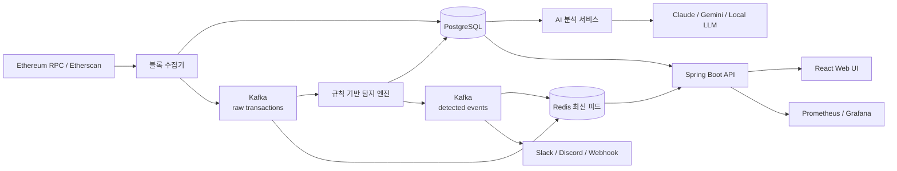

# ChainWatch

[](https://github.com/bitofsyn/ChainWatch/actions/workflows/ci.yml)

> AI를 활용해 블록체인 거래 데이터를 분석하고 이상 징후를 탐지하는 모니터링 시스템

ChainWatch는 이더리움 블록과 트랜잭션을 수집하고, 규칙 기반 탐지 엔진으로 의심스러운 거래 패턴을 식별하는 프로젝트입니다. 탐지된 이벤트는 위험도와 근거 데이터와 함께 저장되며, 필요한 경우 LLM이 이벤트를 추가 분석해 사람이 검토하기 쉬운 보고서를 생성합니다.

단순히 AI에게 거래 판단을 맡기지 않고, **재현 가능한 규칙이 먼저 이상 징후와 근거를 생성하고 AI는 그 결과를 해석하는 보조 계층으로 동작**하도록 구현했습니다.

## 주요 기능

- 이더리움 RPC 또는 Etherscan을 통한 블록·트랜잭션 수집
- 폴링 및 WebSocket 수집 방식 지원
- 규칙 기반 이상 거래 탐지와 탐지 근거 저장
- Kafka를 이용한 수집·탐지·알림 단계 분리
- Redis를 이용한 최신 거래·이벤트 피드와 알림 중복 방지
- Claude, Gemini, LM Studio, Hermes 기반 AI 분석 및 프로바이더 폴백
- 이벤트 상태 관리, 거래·지갑 상세 조회, 탐지 기준값 관리
- JWT 인증, 역할 기반 접근 제어와 감사 로그
- Slack, Discord 및 일반 Webhook 알림
- Prometheus 지표와 Grafana 대시보드를 통한 운영 상태 확인

## 시스템 구조



### 처리 흐름

1. **수집**: 백엔드가 블록체인 제공자에서 블록과 트랜잭션을 가져옵니다.
2. **저장 및 발행**: 원본 거래를 PostgreSQL에 저장하고 Kafka 토픽으로 발행합니다.
3. **탐지**: 탐지 엔진이 각 거래를 여러 규칙으로 평가합니다.
4. **근거 기록**: 조건을 만족하면 위험도, 탐지 유형, 임계값, 관측값 등 판단 근거를 이벤트에 저장합니다.
5. **후속 처리**: 이벤트를 Redis 피드에 반영하고 설정된 외부 채널로 알립니다.
6. **AI 분석**: 고위험 이벤트는 AI 분석 서버가 요약, 가능 시나리오, 오탐 요인, 권장 조치와 신뢰도를 생성합니다.
7. **검토**: 사용자는 웹 화면에서 이벤트를 조회하고 상태를 변경하거나 관련 거래와 지갑을 추적합니다.

수집과 탐지는 동기 방식으로도 실행할 수 있지만, 기본 통합 환경에서는 Kafka를 이용해 각 단계를 분리합니다. 특정 외부 서비스가 느려지더라도 전체 파이프라인이 함께 멈추지 않도록 재시도, 백오프, Dead Letter 처리와 상태 지표를 포함했습니다.

## 탐지 규칙

| 탐지 유형 | 판단 기준 | 기본 위험도 |
|---|---|---|
| 고액 송금 (`LARGE_TRANSFER`) | 설정한 ETH 기준값 이상의 단일 송금 | HIGH |
| 단시간 반복 송금 (`RAPID_TRANSFER`) | 지정 시간 동안 동일 지갑에서 발생한 송금 횟수 | MEDIUM |
| 자금 분산 (`FAN_OUT`) | 지정 시간 동안 한 지갑이 다수의 서로 다른 주소로 송금 | HIGH |
| 거래소 자금 이동 (`EXCHANGE_FLOW`) | 등록된 거래소 주소와 기준값 이상의 자금 이동 | HIGH |
| 관심 주소 활동 (`WHALE_ACTIVITY`) | Watchlist에 등록된 주소가 거래에 참여 | HIGH |
| 제재 주소 활동 (`SANCTIONED_ADDRESS`) | OFAC 제재 목록의 주소가 거래에 참여 | CRITICAL |

각 이벤트에는 단순한 결과만 저장하지 않고 `thresholdEth`, `observedAmountEth`, `windowMinutes`, `matchedAddress` 등 규칙별 판단 근거도 함께 기록합니다. 임계값은 관리자 API와 화면에서 변경할 수 있습니다.

## AI 분석 방식

AI 분석 서버는 Python과 FastAPI로 구현했으며, 백엔드에서 탐지 이벤트를 전달받아 구조화된 분석 결과를 반환합니다.

- 공통 `ModelAdapter` 인터페이스로 AI 제공자를 분리했습니다.
- Claude, Gemini와 OpenAI 호환 로컬 모델 서버를 지원합니다.
- 요청한 제공자가 실패하면 설정된 순서에 따라 다음 제공자로 전환합니다.
- 재시도와 지수 백오프를 적용하며, 모든 제공자가 실패하면 성공한 것처럼 꾸미지 않고 분석 실패로 기록합니다.
- LLM 응답이 JSON 스키마와 맞지 않으면 원문 보고서만 보존하는 방식으로 안전하게 저하됩니다.
- 거래 데이터는 프롬프트 내부에서 명령이 아닌 신뢰할 수 없는 입력 데이터로 구분해 전달합니다.

AI 결과에는 위험 요약, 판단 근거, 가능한 시나리오, 권장 조치, 오탐 가능성, 신뢰도와 에스컬레이션 수준이 포함될 수 있습니다. AI 분석은 규칙 탐지 결과를 설명하는 보조 수단이며 최종 의사결정을 대체하지 않습니다.

## 기술 스택

| 영역 | 기술 |
|---|---|
| Backend | Java 21, Spring Boot 3.5, Spring Security, Spring Data JPA, Web3j |
| Frontend | React 18, TypeScript, Vite, Vitest |
| AI Server | Python, FastAPI, Pydantic |
| Database | PostgreSQL 16, H2 |
| Messaging / Cache | Apache Kafka, Redis |
| Monitoring | Spring Actuator, Micrometer, Prometheus, Grafana |
| Infrastructure | Docker, Docker Compose, Nginx |

## 저장소 구성

```text
ChainWatch/
├── backend/                    # API, 수집기, 탐지 엔진, 인증과 데이터 저장
├── frontend/                   # 모니터링 및 관리자 웹 화면
├── ai/analysis-server/         # LLM 어댑터와 분석 API
├── infra/monitoring/           # Prometheus·Grafana 설정
├── docker-compose.yml          # 전체 로컬 실행 환경
└── README.md
```

## 주요 화면

- **대시보드**: 이벤트 통계, 위험도 분포와 파이프라인 상태 확인
- **탐지 이벤트**: 조건별 검색, 상세 근거 확인, 처리 상태 변경
- **거래·지갑 상세**: 관련 거래와 주소 활동 추적
- **탐지 규칙**: 현재 임계값 조회 및 관리자 변경
- **AI 분석**: 이벤트별 분석 결과와 처리 상태 확인
- **관리자**: 사용자, 감사 로그, 파이프라인과 운영 정책 관리
- **에이전트 운영 화면**: 작업 팀 상태, 인계와 장애 상태 확인

## 빠른 실행

### 사전 준비

- Docker Desktop 및 Docker Compose
- 전체 서비스를 컨테이너로 실행하지 않을 경우 Java 21, Node.js와 Python 3

### 전체 서비스 실행

저장소 루트에서 다음 명령을 실행합니다.

```bash
docker compose --profile app up --build
```

| 서비스 | 주소 |
|---|---|
| Web UI | http://localhost |
| Backend API | http://127.0.0.1:18080 |
| Swagger UI | http://127.0.0.1:18080/swagger-ui.html |
| AI Analysis API | http://127.0.0.1:8000 |
| Grafana | http://127.0.0.1:3000 |
| Prometheus | http://127.0.0.1:9090 |
| Kafka UI | http://127.0.0.1:8081 |

서비스를 종료할 때는 다음 명령을 사용합니다.

```bash
docker compose --profile app down
```

## 환경 설정

비밀값은 저장소에 파일로 커밋하지 않고 실행 환경에서 주입합니다. 필요한 기능만 선택적으로 활성화할 수 있습니다.

```bash
# 블록 수집
export CHAINWATCH_COLLECTOR_ENABLED=true
export CHAINWATCH_ETHERSCAN_API_KEY="발급받은 키"

# AI 분석
export CHAINWATCH_AI_ENABLED=true
export ANTHROPIC_API_KEY="발급받은 키"
export GEMINI_API_KEY="발급받은 키"

# 인증을 활성화하는 경우 반드시 운영용 값으로 변경
export CHAINWATCH_JWT_ENABLED=true
export CHAINWATCH_JWT_SECRET="충분히 긴 임의 문자열"
export CHAINWATCH_PASSWORD_PEPPER="별도로 관리하는 임의 문자열"
export CHAINWATCH_ADMIN_USERNAME="관리자 계정"
export CHAINWATCH_ADMIN_PASSWORD="{bcrypt}..."
```

| 변수 | 설명 | 기본 상태 |
|---|---|---|
| `CHAINWATCH_COLLECTOR_ENABLED` | 자동 블록 수집 활성화 | `false` |
| `CHAINWATCH_COLLECTOR_PROVIDER` | `rpc` 또는 `etherscan` 선택 | `rpc` |
| `CHAINWATCH_COLLECTOR_MODE` | `polling` 또는 `websocket` 선택 | `polling` |
| `CHAINWATCH_AI_ENABLED` | AI 분석 연동 활성화 | `false` |
| `ANTHROPIC_API_KEY` | Claude API 인증 키 | 미설정 |
| `GEMINI_API_KEY` | Gemini API 인증 키 | 미설정 |
| `CHAINWATCH_JWT_ENABLED` | JWT 인증 활성화 | `false` |
| `CHAINWATCH_SLACK_WEBHOOK_URL` | Slack 알림 Webhook | 미설정 |
| `CHAINWATCH_DISCORD_WEBHOOK_URL` | Discord 알림 Webhook | 미설정 |

AI 제공자와 모델, 폴백 순서에 관한 상세 설정은 [`ai/analysis-server/README.md`](ai/analysis-server/README.md)에서 확인할 수 있습니다.

## 주요 API

| 영역 | 경로 | 설명 |
|---|---|---|
| 상태 확인 | `GET /api/health` | 백엔드 상태 확인 |
| 이벤트 | `GET /api/events` | 탐지 이벤트 검색 및 페이지 조회 |
| 이벤트 | `GET /api/events/{id}` | 이벤트와 탐지 근거 상세 조회 |
| 이벤트 | `PATCH /api/events/{id}/status` | 이벤트 처리 상태 변경 |
| AI 분석 | `POST /api/events/{id}/analysis` | 이벤트 AI 분석 실행 |
| 거래 | `GET /api/transactions` | 수집된 거래 조회 |
| 지갑 | `GET /api/wallets/{address}` | 지갑 활동 요약 조회 |
| 탐지 규칙 | `GET /api/detection/rules` | 규칙 및 임계값 조회 |
| 탐지 규칙 | `PATCH /api/detection/rules/thresholds` | 임계값 변경 |
| 수집기 | `GET /api/collector/state` | 현재 수집 상태 조회 |
| 운영 | `GET /api/ops/pipeline` | 파이프라인 상태 조회 |
| 인증 | `POST /api/auth/login` | 로그인 및 토큰 발급 |

전체 명세는 서비스를 실행한 뒤 Swagger UI에서 확인할 수 있습니다.

## 개별 실행 및 테스트

### Backend

```bash
cd backend
./gradlew bootRun
./gradlew test
```

### Frontend

```bash
cd frontend
npm ci
npm run dev
npm test
npm run build
```

### AI Analysis Server

```bash
cd ai/analysis-server
python3 -m venv .venv
source .venv/bin/activate
pip install -r requirements-dev.txt
uvicorn app.main:app --port 8000
pytest -q
```

## 보안 및 운영 시 주의사항

- `.env`, API 키, 개인 키, 인증서와 자격 증명 파일은 Git 추적 대상에서 제외됩니다.
- 저장소의 기본 계정과 비밀번호는 로컬 개발 편의를 위한 값이며 운영 환경에서 사용하면 안 됩니다.
- 운영 환경에서는 JWT 비밀키, 비밀번호 pepper, 관리자 비밀번호와 Grafana 비밀번호를 반드시 교체해야 합니다.
- Webhook URL과 AI API 키는 환경변수 또는 별도의 Secret Manager로 관리해야 합니다.
- AI가 생성한 내용은 참고 자료이며 제재 판단, 자금 동결과 같은 최종 조치에는 사람의 검토가 필요합니다.
- 공개 RPC는 호출 제한과 데이터 신뢰성 문제가 있을 수 있으므로 운영 환경에서는 전용 제공자와 모니터링을 권장합니다.

## 프로젝트 범위

ChainWatch는 이상 징후의 자동 수집·탐지·설명과 운영 흐름을 구현한 프로젝트입니다. 모든 자금세탁 행위를 확정적으로 판별하거나 법적 제재 여부를 자동 결정하는 시스템은 아닙니다. 규칙과 임계값은 대상 네트워크, 거래량과 운영 정책에 맞게 조정해야 합니다.
