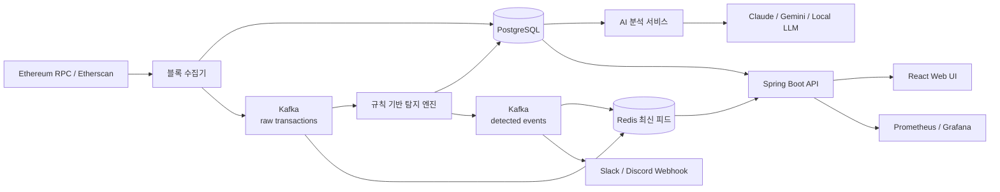

# 시스템 구조

## 처리 흐름

1. **수집**: 백엔드가 블록체인 제공자에서 블록과 트랜잭션을 가져옵니다.
2. **저장 및 발행**: 원본 거래를 PostgreSQL에 저장하고 Kafka 토픽으로 발행합니다.
3. **탐지**: 탐지 엔진이 각 거래를 여러 규칙으로 평가합니다.
4. **근거 기록**: 조건을 만족하면 위험도, 탐지 유형, 임계값, 관측값 등 판단 근거를 이벤트에 저장합니다.
5. **후속 처리**: 이벤트를 Redis 피드에 반영하고 설정된 외부 채널로 알립니다.
6. **AI 분석**: AI 연동을 켜면 자동 분석 워커나 분석가 요청으로 고위험 이벤트를 AI 분석 서버에 보내고, 서버가 요약, 가능 시나리오, 오탐 요인, 권장 조치와 신뢰도를 생성합니다. 워커는 종결되지 않은 이벤트를 위험 점수가 높은 순, 같은 점수면 최신순으로 고릅니다.
7. **검토**: 사용자는 웹 화면에서 이벤트를 조회하고 상태를 변경하거나 관련 거래와 지갑을 추적합니다.

수집과 탐지는 동기 방식으로도 실행할 수 있지만, 기본 통합 환경에서는 Kafka를 이용해 각 단계를 분리합니다. 특정 외부 서비스가 느려지더라도 전체 파이프라인이 함께 멈추지 않도록 재시도, 백오프, Dead Letter 처리와 상태 지표를 포함했습니다.

## 탐지 규칙

| 탐지 유형 | 판단 기준 | 기본 위험도 |
|---|---|---|
| 고액 송금 (`LARGE_TRANSFER`) | 설정한 ETH 기준값 이상의 단일 송금 | HIGH |
| 단시간 반복 송금 (`RAPID_TRANSFER`) | 지정 시간 동안 동일 지갑에서 발생한 송금 횟수 | MEDIUM |
| 자금 분산 (`FAN_OUT`) | 지정 시간 동안 한 지갑이 다수의 서로 다른 주소로 송금 | HIGH |
| 자사 지갑 대량 입출금 (`EXCHANGE_FLOW`) | 등록된 거래소 주소(자사 입출금 지갑)와 기준값 이상의 자금 이동 | HIGH |
| 관심 주소 활동 (`WHALE_ACTIVITY`) | Watchlist에 등록된 주소가 거래에 참여 | HIGH |
| 제재 주소 활동 (`SANCTIONED_ADDRESS`) | OFAC 제재 목록의 주소가 거래에 참여 | CRITICAL |

자사 입출금 지갑은 고객 출금을 한꺼번에 보내므로 반복 송금·자금 분산 판정에서 제외하고, 대량 입출금만 `EXCHANGE_FLOW`로 봅니다. 기본 기준값은 대규모 이체 100 ETH, 자사 지갑 입출금 50 ETH, 반복 송금 10분 20회, 자금 분산 15분 20개 주소이며, 반복 송금·자금 분산·관심 주소는 같은 지갑을 30분 동안 1건으로 묶습니다.

각 이벤트에는 단순한 결과만 저장하지 않고 `thresholdEth`, `observedAmountEth`, `windowMinutes`, `matchedAddress` 등 규칙별 판단 근거도 함께 기록합니다. 임계값은 관리자 API와 화면에서 변경할 수 있습니다.

## AI 분석 방식

AI 분석 서버는 Python과 FastAPI로 구현했으며, 백엔드에서 탐지 이벤트를 전달받아 구조화된 분석 결과를 반환합니다.

- 공통 `ModelAdapter` 인터페이스로 AI 제공자를 분리했습니다.
- Claude, Gemini와 OpenAI 호환 로컬 모델 서버를 지원합니다.
- 요청한 제공자가 실패하면 설정된 순서에 따라 다음 제공자로 전환합니다.
- 제공자마다 재시도하고 시도할 때마다 대기 시간을 늘립니다. 모든 제공자가 실패하면 성공한 것처럼 꾸미지 않고 분석 실패로 기록합니다.
- Gemini는 기본 모델이 과부하·한도 초과·응답 지연이면 예비 모델로 바로 넘어가, 백엔드의 요청 제한 시간(120초) 안에 결과를 돌려줍니다.
- 공개 주소로 띄운 AI 서버는 백엔드와 공유한 토큰(`X-ChainWatch-AI-Token`)이 맞는 요청만 처리합니다.
- LLM 응답이 JSON 스키마와 맞지 않으면 원문 보고서만 보존하는 방식으로 안전하게 저하됩니다.
- 거래 데이터는 프롬프트 내부에서 명령이 아닌 신뢰할 수 없는 입력 데이터로 구분해 전달합니다.

AI 결과에는 위험 요약, 판단 근거, 가능한 시나리오, 권장 조치, 오탐 가능성, 신뢰도와 에스컬레이션 수준이 포함될 수 있습니다. AI 분석은 규칙 탐지 결과를 설명하는 보조 수단이며 최종 의사결정을 대체하지 않습니다.

AI 제공자와 모델, 폴백 순서 설정은 [`ai/analysis-server/README.md`](../ai/analysis-server/README.md)를 참고하세요.
