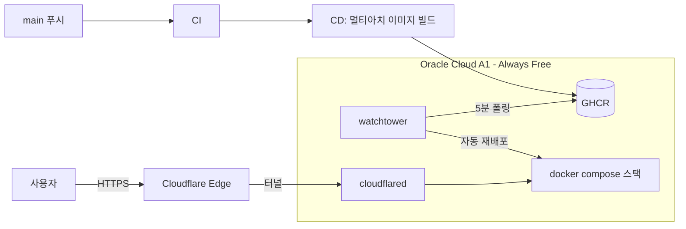

# 상시 운영 배포 가이드 (무료)

노트북이 꺼져 있어도 데모가 계속 동작하도록, 상시 구동되는 무료 서버에 배포하는 절차입니다.

- **서버**: Oracle Cloud Always Free — Ampere A1(ARM) 4 OCPU / 24GB RAM / 200GB 스토리지가 영구 무료라 Kafka·JVM을 포함한 전체 스택을 올릴 수 있는 사실상 유일한 무료 티어입니다.
- **이미지**: CD 워크플로가 GHCR에 게시하는 멀티아치(amd64·arm64) 이미지를 pull만 해서 사용합니다. VPS에서 소스를 빌드하지 않습니다.
- **공개**: Cloudflare Tunnel. 아웃바운드 연결만 사용하므로 서버 방화벽에 인바운드 포트를 열지 않습니다.

## 1. Oracle Cloud 인스턴스 준비

1. [Oracle Cloud 무료 계정](https://www.oracle.com/kr/cloud/free/)을 생성합니다. 카드 인증이 필요하지만 Always Free 자원만 쓰면 과금되지 않습니다.
2. **홈 리전은 신중히 선택**합니다(가입 후 변경 불가). 서울·춘천 리전은 A1 용량 부족으로 인스턴스 생성이 실패(`Out of capacity`)할 수 있으며, 이 경우 시간을 바꿔 재시도하거나 다른 가용 도메인을 선택합니다.
3. Compute 인스턴스를 생성합니다.
   - Shape: `VM.Standard.A1.Flex`, **4 OCPU / 24GB RAM** (Always Free 한도 전부 사용 권장)
   - 이미지: Ubuntu 24.04 (aarch64)
   - 부트 볼륨: 기본 47GB면 충분 (무료 한도는 총 200GB)
   - SSH 공개키 등록
4. 네트워크(VCN) 보안 목록은 **SSH(22)만 인바운드 허용**으로 둡니다. 웹 공개는 터널이 담당하므로 80·443을 열 필요가 없습니다.

> **유휴 회수 주의**: Oracle은 장기간 유휴 상태인 Always Free 인스턴스를 회수할 수 있습니다. 수집기가 켜진 상태로 상시 구동되면 보통 문제없지만, 확실히 하려면 계정을 PAYG(Pay As You Go)로 전환해 두는 방법이 있습니다. Always Free 자원만 쓰는 한 전환 후에도 요금은 발생하지 않습니다.

## 2. Docker 설치

SSH 접속 후 공식 저장소에서 Docker를 설치합니다.

```bash
curl -fsSL https://get.docker.com | sudo sh
sudo usermod -aG docker "$USER"
# 그룹 반영을 위해 재접속
```

## 3. 애플리케이션 배포

```bash
git clone https://github.com/bitofsyn/ChainWatch.git
cd ChainWatch

cp .env.prod.example .env
vi .env   # 모든 비밀값을 새로 생성해 입력 (openssl rand -base64 48)

docker compose -f docker-compose.prod.yml --profile tunnel-quick --profile autoupdate up -d
curl --fail http://127.0.0.1:18080/actuator/health
```

- GHCR 이미지(`chainwatch-backend`, `chainwatch-frontend`, `chainwatch-ai-analysis`)가 **public**으로 설정되어 있어야 로그인 없이 pull됩니다. private이면 GitHub Packages 설정에서 public으로 바꾸거나, VPS에서 `read:packages` 권한의 PAT로 `docker login ghcr.io` 합니다.
- `autoupdate` 프로필은 watchtower를 함께 띄워 5분 간격으로 GHCR을 확인하고, main 브랜치 CD가 새 이미지를 게시하면 자동으로 재배포합니다. 수동 배포를 원하면 이 프로필을 빼고 `docker compose -f docker-compose.prod.yml pull && docker compose -f docker-compose.prod.yml up -d`를 직접 실행합니다.

## 4. 공개 주소 확인

```bash
docker compose -f docker-compose.prod.yml logs cloudflared-quick | grep -o 'https://.*trycloudflare.com'
```

출력된 `https://....trycloudflare.com` 주소가 공개 데모 주소입니다. README의 데모 링크를 이 주소로 갱신합니다.

### Quick Tunnel의 한계와 주소 고정

Quick Tunnel은 무료지만 **터널 컨테이너가 재시작되면 주소가 바뀝니다**(`restart: always`로 프로세스가 유지되는 동안은 동일 주소 유지). 주소를 고정하려면 도메인 하나(연 1~2만 원 수준)만 있으면 됩니다.

1. 도메인을 Cloudflare에 등록(네임서버 이전, 무료 플랜)
2. [Zero Trust 대시보드](https://one.dash.cloudflare.com/) → Networks → Tunnels에서 터널 생성, 토큰 복사
3. Public Hostname을 `http://frontend:80`으로 연결
4. VPS `.env`에 `CLOUDFLARE_TUNNEL_TOKEN=...` 추가 후 프로필 교체:

```bash
docker compose -f docker-compose.prod.yml --profile tunnel-quick down cloudflared-quick
docker compose -f docker-compose.prod.yml --profile tunnel-named --profile autoupdate up -d
```

## 5. 운영 점검

| 작업 | 명령 |
|---|---|
| 전체 상태 확인 | `docker compose -f docker-compose.prod.yml ps` |
| 백엔드 헬스 체크 | `curl http://127.0.0.1:18080/actuator/health` |
| 백엔드 로그 | `docker compose -f docker-compose.prod.yml logs -f backend` |
| 특정 버전으로 롤백 | `.env`의 `IMAGE_TAG`에 커밋 SHA 지정 후 `up -d` |
| 전체 종료 | `docker compose -f docker-compose.prod.yml --profile tunnel-quick --profile autoupdate down` |

재부팅 후에도 모든 서비스가 `restart: always`로 자동 복구되므로 별도의 systemd 설정은 필요 없습니다.

## 구성 요약


